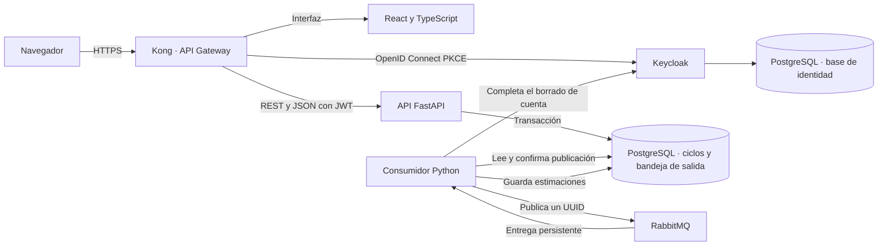

# Ritmo

Ritmo es una aplicación web en español para registrar el inicio de la menstruación, consultar el historial y obtener estimaciones orientativas para la planificación del embarazo. El repositorio contiene un proyecto académico y ejemplos ficticios.

## Arranque local

Requisitos: Docker con el complemento Compose, OpenSSL y un navegador.

```sh
./scripts/setup-local.sh
docker compose up --build -d --wait
```

1. Abre [Ritmo](https://localhost:8443/). El certificado de desarrollo se genera localmente. Verifica que corresponde a `.local/tls/cert.pem` y acepta la excepción para este entorno en el navegador.
2. Explora el calendario en modo demo. Sus fechas son ficticias y los cambios duran hasta que recargas la página.
3. Elige **Iniciar sesión**, luego **Crear cuenta**, y registra una cuenta ficticia. Tras confirmar el consentimiento, agrega una menstruación y la duración habitual del ciclo. Puedes editar registros y borrar datos desde **Historial** y **Configuración**.

La configuración local crea contraseñas aleatorias en `.env` y un certificado en `.local/tls`. Ambos están excluidos de Git. Si 8443 está ocupado, ejecuta `HTTPS_PORT=9443 ./scripts/setup-local.sh` al preparar una configuración nueva. Para detener la aplicación y conservar los datos, usa `docker compose down`.

## Arquitectura del curso



- Kong recibe HTTPS, enruta a los servicios, limita solicitudes y bloquea la administración pública de Keycloak. Los servicios internos quedan en la red de Compose.
- Keycloak autentica con OpenID Connect y PKCE. La API valida la firma RS256, el emisor, la audiencia y el cliente del token. Cada consulta y modificación de registros está acotada al identificador del usuario autenticado.
- FastAPI valida el consentimiento y guarda el registro junto al evento en una transacción. El consumidor publica la fila pendiente en RabbitMQ con confirmación del broker. El mensaje contiene solo un UUID opaco. Al recibirlo, consulta la versión actual del historial, guarda la estimación y confirma la entrega. Si se repite un mensaje, la versión y la fila de salida permiten procesarlo sin duplicar el efecto.
- Borrar el historial elimina fechas, preferencias y estimaciones. Borrar una cuenta elimina esos datos en la misma transacción y encola la eliminación de la identidad en Keycloak. El consumidor reintenta las tareas pendientes. El cliente no almacena el historial ni los tokens en almacenamiento persistente del navegador.

Los registros de acceso de Kong, Nginx y Uvicorn están desactivados. Las fechas se reciben en el cuerpo JSON y se excluyen de RabbitMQ. La configuración de Compose publica HTTPS solo en la interfaz local y usa un certificado de desarrollo. Usa datos ficticios con esta configuración.

## API

La documentación interactiva está en [Swagger UI](https://localhost:8443/api/docs) y el contrato en [OpenAPI JSON](https://localhost:8443/api/openapi.json). Las rutas bajo `/api/v1` requieren un token de acceso de `ritmo-web`.

| Método | Ruta | Operación |
| --- | --- | --- |
| GET | `/dashboard` | Consentimiento, historial, preferencias y estimación |
| POST | `/consent` | Confirmar el uso de datos |
| POST | `/cycles` | Registrar la fecha y, opcionalmente, la duración habitual |
| PUT, DELETE | `/cycles/{id}` | Editar o borrar una fecha propia |
| PUT | `/preferences` | Actualizar duración y regularidad |
| DELETE | `/history` | Eliminar registros y estimaciones |
| DELETE | `/account` | Eliminar los datos y solicitar el borrado de la identidad |

## Cómo se estiman las fechas

Con al menos tres registros, Ritmo promedia hasta los últimos seis intervalos. Con menos registros necesita al menos una fecha y la duración habitual declarada. En un ciclo de 28 días estima la ovulación en el día 14, contando el inicio de la menstruación como día 1. La ventana orientativa abarca ese día y los cinco anteriores. No muestra fechas precisas si el ciclo se declara irregular, si un intervalo usado queda fuera de 21 a 35 días o si la diferencia entre el mayor y el menor supera siete días. Estos umbrales son criterios de este prototipo. Si la menstruación estimada ya pasó, el calendario pide actualizar el historial.

Las estimaciones no confirman la ovulación ni diagnostican la fertilidad. La aplicación no sirve como anticonceptivo. [Orientación clínica de ASRM](https://www.asrm.org/practice-guidance/practice-committee-documents/optimizing-natural-fertility-a-committee-opinion-2021/)

## Pruebas

```sh
(cd backend && python -m unittest discover -s tests -v)
python -m pip install -r backend/requirements.txt
python scripts/integration.py
```

GitHub Actions compila el stack y ejecuta las pruebas de cálculo y de integración. La integración crea cuentas ficticias y verifica HTTPS, el registro y el inicio de sesión con PKCE, el consentimiento, el aislamiento entre cuentas, el recálculo y el borrado.
